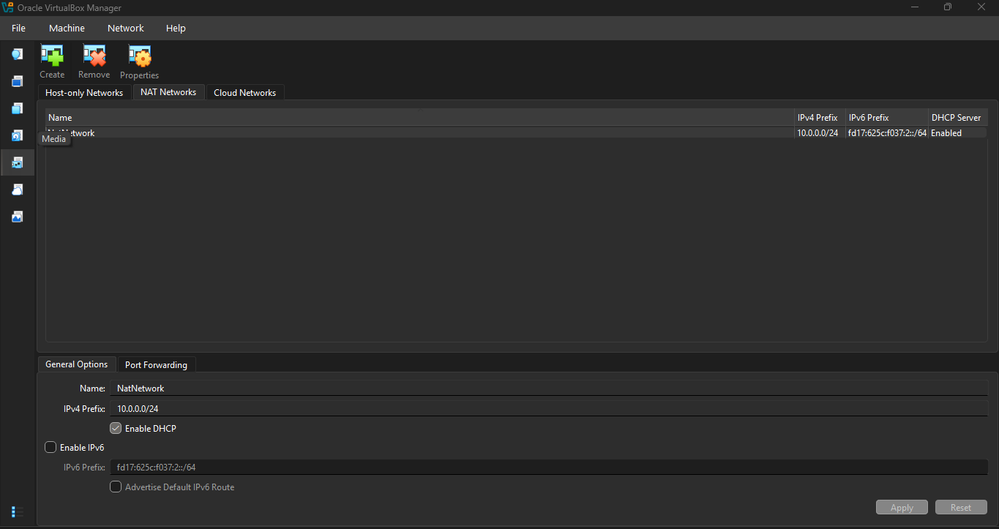
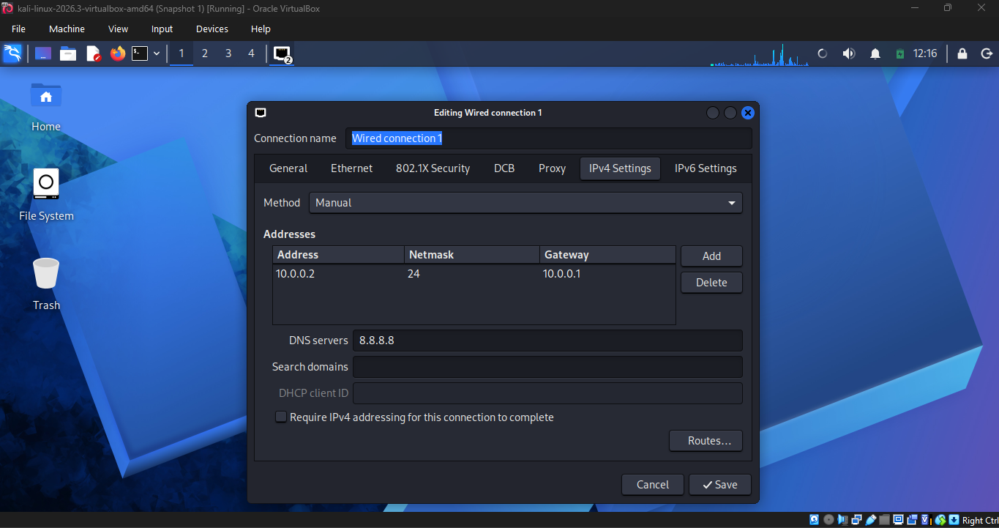
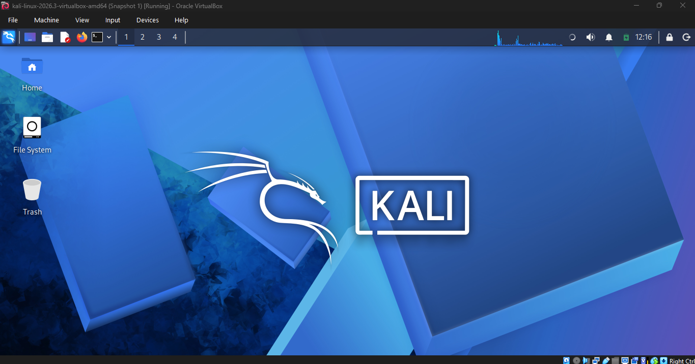

# Cybersecurity Lab Environment Setup

## Project Overview

This project documents how I set up a virtual cybersecurity testing lab on my computer using **Oracle VirtualBox** and **Kali Linux**.

The goal was to create a practical environment where I can develop my cybersecurity skills, explore security tools, and carry out authorized testing in future projects.

I completed the installation, virtual network configuration, Kali Linux IP configuration, and VM snapshot successfully.

## Project Objectives

- Install the tools required for the lab.
- Set up Kali Linux in Oracle VirtualBox.
- Create a NAT Network using the `10.0.0.0/24` subnet.
- Configure a static IPv4 address for Kali Linux.
- Save a snapshot of the configured virtual machine.

## Tools Used

| Tool | Purpose |
| --- | --- |
| [7-Zip](https://www.7-zip.org/download.html) | Extracting the downloaded Kali Linux VM archive |
| [Oracle VirtualBox](https://www.virtualbox.org/wiki/Downloads) | Running the virtual machine |
| [Kali Linux](https://www.kali.org/get-kali/) | Operating system for cybersecurity practice |

## Setup Process

### Step 1: Install 7-Zip

I downloaded and installed **7-Zip** from its official website. I used it to extract the Kali Linux virtual machine files after downloading them.

Download: https://www.7-zip.org/download.html

### Step 2: Install Oracle VirtualBox

Next, I downloaded and installed **Oracle VirtualBox**. VirtualBox allows me to run Kali Linux as a virtual machine on my computer without replacing my main operating system.

Download: https://www.virtualbox.org/wiki/Downloads

### Step 3: Configure the VirtualBox NAT Network

In VirtualBox, I opened the **Network** settings and created a NAT Network with these settings:

| Setting | Value |
| --- | --- |
| Network name | `NatNetwork` |
| IPv4 network | `10.0.0.0/24` |
| DHCP | Enabled |

The NAT Network allows virtual machines attached to the same network to communicate with one another and can provide outbound connectivity.

### Step 4: Download and Import Kali Linux

I downloaded the prebuilt **Kali Linux VirtualBox virtual machine** from the official Kali Linux website, extracted the archive with 7-Zip, and added the VM to VirtualBox.

I then configured the Kali VM's network adapter to use the NAT Network created in Step 3.

Download: https://www.kali.org/get-kali/

### Step 5: Configure Kali Linux IP Address

After starting Kali Linux, I opened the wired connection's **IPv4 Settings** and changed the method to **Manual**.

I used the following settings:

| Setting | Value |
| --- | --- |
| IPv4 address | `10.0.0.2` |
| Subnet prefix | `/24` (`255.255.255.0`) |
| Gateway | `10.0.0.1` |
| DNS server | `8.8.8.8` |

I saved the settings to complete the static IP configuration.

### Step 6: Take a Virtual Machine Snapshot

Finally, I created a VirtualBox snapshot named **Snapshot 1** after completing the setup.

A snapshot provides a recovery point I can return to if later practice exercises change or disrupt the virtual machine's configuration.

The screenshot below shows Kali Linux running in VirtualBox, with **Snapshot 1** visible in the window title.

## Final Lab Configuration

| Component | Configuration |
| --- | --- |
| Hypervisor | Oracle VirtualBox |
| Virtual machine | Kali Linux 2026.3 |
| Network type | NAT Network |
| Network name | `NatNetwork` |
| Network subnet | `10.0.0.0/24` |
| Kali Linux IP | `10.0.0.2/24` |
| Default gateway | `10.0.0.1` |
| DNS server | `8.8.8.8` |
| Snapshot | `Snapshot 1` |

## What I Learned

Through this task, I gained practical experience with virtualization, VirtualBox network settings, manually assigning an IPv4 address in Kali Linux, and creating snapshots for recovery.

I also learned how a NAT Network can support a lab containing multiple virtual machines for future testing exercises.

## Conclusion

I successfully completed the six required steps and set up my Kali Linux cybersecurity lab environment. The virtual machine and its network configuration are in place, and I have saved a snapshot as a starting point for future projects.

**Note:** This lab is intended for learning and authorized security testing only. Because NAT networking can provide outbound access, additional controls may be needed for exercises that require complete network isolation.
